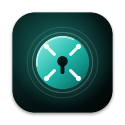
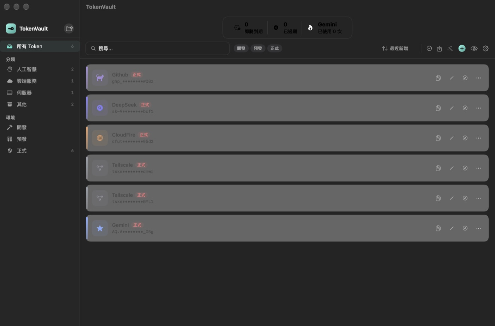
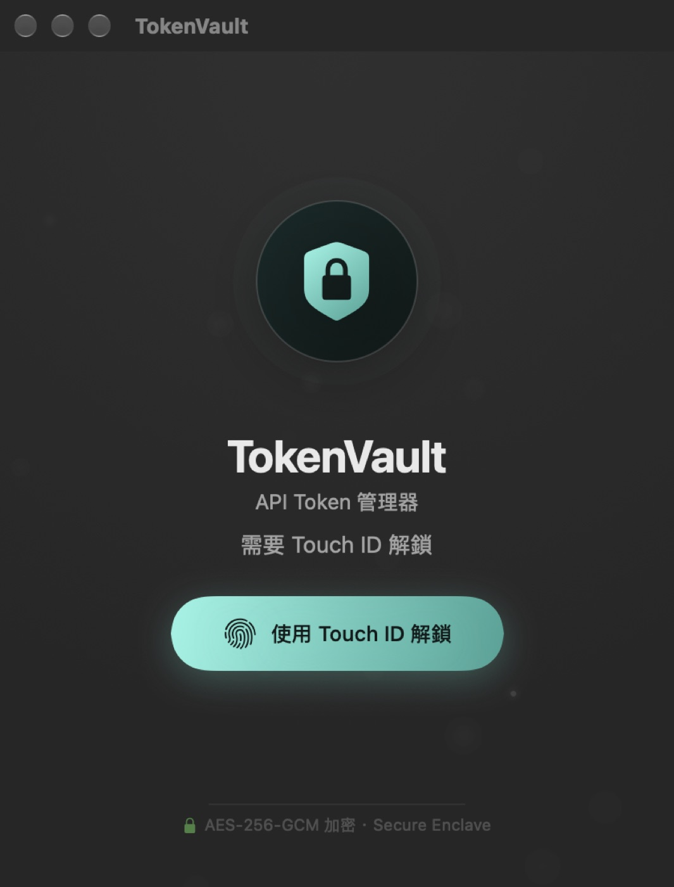
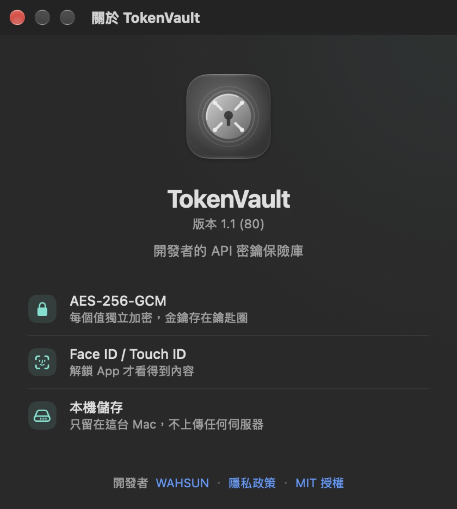
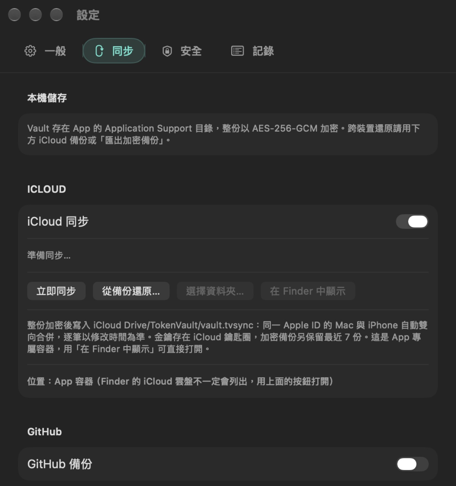

# TokenVault

### An open-source API token manager for macOS and iOS — built for developers

<p align="center">
  
</p>

<p align="center">
  <a href="LICENSE"></a>
  
  
  
  <a href="CONTRIBUTING.md"></a>
  <a href="https://github.com/C92D58/TokenVault/releases"></a>
</p>

TokenVault is an **API secret manager designed for developers**. Unlike a general-purpose password manager, TokenVault is built around what developers actually need: environment labels (dev / staging / prod), automatic provider detection, a built-in JWT decoder, one-click token generation, and menu-bar quick copy — all protected with **AES-256-GCM encryption**.

The same vault now lives on your phone: the iOS build (see [`iOS/`](iOS/)) shares the data model, the crypto and the JSON file format with the Mac app, and adds Face ID unlock, swipe-to-copy, a generator and a JWT decoder built for one-handed use.

TokenVault is **free and open-source software**, released under the [MIT License](LICENSE). Contributions, forks and feedback are welcome.

---

## Requirements

- **Platform:** macOS 14.0 (Sonoma) or later
- **Architecture:** Apple Silicon (arm64)
- **iOS:** iOS 18.0 or later (iPhone, Xcode 26+ to build)
- **Unlock:** Face ID / Touch ID (or device password)

---

## Screenshots



| Lock screen | About | Settings |
|---|---|---|
|  |  |  |

---

## Highlights

### 🔐 Security architecture

- Every token value is encrypted with **AES-256-GCM**
- The master encryption key lives in the **macOS Keychain (Secure Enclave)**
- Keys never leave your device
- **Face ID / Touch ID** biometric unlock
- **Auto-lock on idle** — protects against shoulder surfing
- **Clipboard auto-clear** — wipes copied tokens automatically

### 🧠 Built for developers

- **Automatic detection of 20 providers** — OpenAI, Claude, Gemini, DeepSeek, GitHub, GitLab, AWS, Azure, Google Cloud, Cloudflare, Telegram, Discord, Slack, Stripe, Tailscale, Apple, Docker, Vercel, Supabase, HuggingFace
- **10 token categories** — AI, cloud, database, community, payments, SSH, JWT, certificates, servers, other
- **10 credential formats** — API keys, OAuth tokens, SSH private keys, JWT, cookies, authorization headers, webhooks and more
- **Environment labels** — Development / Staging / Production
- **Built-in JWT decoder** — one-click decode of header + payload
- **Token generator** — custom length and character sets for secure keys
- **Token health checks** — validates GitHub / OpenAI / Cloudflare tokens automatically

### ⚡ Fast workflows

- **Menu-bar popover** — search and copy any token from the menu bar
- **Global shortcut ⌘⇧T** — paste your most-used token inside any app
- **⌘K Spotlight search** — find tokens instantly
- **Keyboard-shortcut HUD** — hold ⌘ for 1.5 s to see every shortcut

### 🔄 Backup & transfer

- **Live iCloud sync** — the vault is sealed with a key from your iCloud keychain and stored at
  `iCloud Drive/TokenVault/vault.tvsync`; every Mac and iPhone on the same Apple ID merges it
  automatically, row by row, newest edit wins. Deletes propagate too.
- **Automatic encrypted snapshots** — the newest 7 backups stay in `iCloud Drive/TokenVault/Backups`
  for one-click restore; the key sits in your iCloud keychain so a replacement device restores with
  nothing to retype
- **Encrypted backups** — export an AES-256-GCM JSON backup, or `.env` / CSV for other tools
- **Multi-format import** — `.env`, CSV, JSON backups, manual paste, drag & drop
- **GitHub private-repo backup** (macOS) — encrypted backup to your own private repo (optional)

### 🎨 Native macOS experience

- **Native SwiftUI interface** — smooth and light, no Electron shell
- **Neutral black palette, one cyan accent** — the ground is greyscale, hairlines carry the structure, and the accent is spent only where something is selected or primary
- **English and Traditional Chinese**, switchable in Settings and applied on the spot, no restart
- **Dark mode** — system / dark / light
- **macOS 26 Liquid Glass** — frosted materials on surfaces, the toast and the add button
- **Pill tab bar, no focus rings** — page switching is plain buttons, so AppKit never draws its blue ring around a tab strip
- **Draws its own lock mark**, and Touch ID asks by itself — there is no button to press
- **SF Symbols animations** — bounce, pulse, replace and other native effects

---

## Installation

### Download

Download the latest `.dmg` from [Releases](https://github.com/C92D58/TokenVault/releases), open it, and drag `TokenVault.app` into `Applications`.

Requires macOS 14 (Sonoma) or later on Apple Silicon. The release build is ad-hoc signed — there is no Developer ID certificate behind it — so the first launch is blocked: go to **System Settings → Privacy & Security** and click **Open Anyway**, or run `xattr -cr /Applications/TokenVault.app`.

An ad-hoc signature cannot carry the iCloud entitlements, so **iCloud sync reports itself unavailable in the downloaded build**. Build it with your own signing team (below) to use sync.

### Build from source

```bash
git clone https://github.com/C92D58/TokenVault.git
cd TokenVault
scripts/build-macos.sh     # swiftc → .build/TokenVault.app, version stamped from project.yml
bash package.sh            # → .build/TokenVault-<version>.dmg
```

The compiled `TokenVault.app` lands in `.build/`. `scripts/build-macos.sh` is the whole macOS build: no Xcode project, no third-party packages, and it stamps `CFBundleShortVersionString` from `project.yml` plus the commit count as the build number.

### Build the iOS app

```bash
cd iOS
./build.sh          # builds, installs and launches on a simulator
./verify.sh         # runs the acceptance suite (XCUITest)
./scripts/device.sh # installs on a connected iPhone
```

See [`iOS/README.md`](iOS/README.md) for the screens, the test list and how secrets move between
the two builds.

---

## Quick start

### Add your first token

1. Click the **＋** button in the top-right of the main window (or press `⌘N`)
2. Enter a name and value (masked with `SecureField`)
3. Choose an environment (dev / staging / prod) and a provider (auto-detected)
4. Optional: expiry date, group, notes
5. Click **Save** — the token is encrypted with AES-256-GCM and written to disk immediately

### Quick copy

- **Menu bar:** click the 🔑 icon → search → click to copy
- **Shortcut:** `⌘⇧T` pastes your most-used token directly
- **Main window:** click the copy icon next to a token card (or double-click the card)

### Import existing tokens

- Drag `.env` / `.csv` / `.json` backup files onto the main window
- Or click **Import** → choose a file → preview → confirm

---

## Shortcut Reference

| Shortcut | Action |
|----------|--------|
| `⌘⇧T` | paste most-used token globally |
| `⌘N` | new token |
| `⇧⌘N` | new group |
| `⌘K` | Spotlight search |
| `⌘L` | lock TokenVault |
| `⌘,` | open settings |
| `⌘E` | export backup |
| `⌘I` | import backup |
| `⌘W` | close window |
| `⌘Q` | quit TokenVault |
| hold `⌘` for 1.5 s | show shortcut HUD |

---

## Tech Stack

| Layer | Technology |
|-------|------------|
| **Language** | Swift |
| **UI** | SwiftUI + AppKit |
| **Crypto** | CryptoKit (AES-256-GCM) |
| **Key storage** | Security Framework (Keychain Services) |
| **Biometrics** | LocalAuthentication |
| **Persistence** | Codable + JSON (iCloud Drive / local) |
| **Third-party libraries** | none (zero dependencies) |

---

## Project Structure

```
TokenVault/
├── Sources/
│   ├── App/              # macOS app entry + AppDelegate
│   ├── Core/             # SHARED with iOS: models, AES-GCM, Keychain, import/export, health checks
│   ├── DesignSystem/     # design system (tokens, materials, effects)
│   ├── Services/         # macOS services (store, clipboard, settings, backup, auth)
│   └── Views/            # macOS view layer (main screen, editor, settings, etc.)
├── iOS/                  # iOS app: Xcode project, views, UI-test suite, build scripts
├── scripts/
│   ├── build-macos.sh    # macOS build: swiftc → .build/TokenVault.app
│   ├── make-icon.swift   # one icon design, macOS + iOS framings
│   └── make-macos-store-shots.swift
├── docs/screenshots/     # README imagery
├── Assets.xcassets/      # app icons & color assets
├── Resources/            # Info.plist, entitlements, .icns, privacy manifest
├── project.yml           # xcodegen source for the signed macOS target
├── package.sh            # DMG packaging (version read from project.yml)
└── publish.sh            # build → sign → package → optional notarize
```

---

## Security Notes

TokenVault's encryption architecture:

1. Every token value is encrypted with **AES-256-GCM** before being written to disk
2. The encryption key lives in the **macOS Keychain**, protected by Secure Enclave
3. Device keys **never** leave your device
4. iCloud only ever stores ciphertext: the sync file is sealed with a separate key kept in your
   **iCloud Keychain**, and each device re-encrypts every value with its own key when it stores it
5. Biometrics (Face ID / Touch ID) unlock the app itself

> TokenVault **does not** use any remote server, analytics or third-party network service. The only
> copy outside your devices is the encrypted file in your own iCloud Drive.

Found a vulnerability? Please report it privately — see [SECURITY.md](SECURITY.md). Do not open a public issue.

---

## Contributing

All contributions are welcome — bug reports, feature suggestions, pull requests.

- Read [CONTRIBUTING.md](CONTRIBUTING.md) before opening a PR
- Building locally is one command: `scripts/build-macos.sh` (no Xcode project file, zero dependencies).
  That build is ad-hoc signed, so **iCloud sync reports itself unavailable** in it — macOS only
  grants `com.apple.developer.icloud-*` entitlements to a properly signed app.
- For a signed macOS build with working iCloud sync: `xcodegen generate && xcodebuild -project
  TokenVault.xcodeproj -scheme TokenVault -configuration Debug -allowProvisioningUpdates
  -allowProvisioningDeviceRegistration build`. `project.yml` and `build.sh` compile the same
  `Sources/`; nothing is duplicated.

---

## License

[MIT License](LICENSE)

This software is provided "as is", without warranty of any kind, express or implied.

---

<p align="center">
  <sub>🔐 Security is no small matter</sub>
</p>
